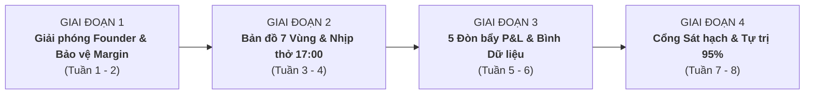

# LỘ TRÌNH CHI TIẾT 4 GIAI ĐOẠN TRIỂN KHAI TÍNH NĂNG CÒN THIẾU
## Hệ Điều Hành Doanh Nghiệp Thực Chiến RAI² First OS (Ngách SME 5–20 Nhân Sự)
**Căn cứ:** *The AI-First Company*, 10 Tài liệu Đồng hành (Companion Guides) của Benjamin Simkin, Triết lý RAI² First OS và P&L thực tế.

---

## TỔNG QUAN CHIẾN LƯỢC: NGUYÊN TẮC PHÂN KỲ TRIỂN KHAI

Để tránh bẫy **"Xây quá nhiều thứ phức tạp mà không giải quyết được P&L"**, toàn bộ các tính năng còn thiếu được sắp xếp theo đúng quy luật sinh tồn của doanh nghiệp 5–20 nhân sự:

$$\text{Giải phóng Người chủ (MeOS)} \longrightarrow \text{Minh bạch hóa Dòng tiền & Vận hành} \longrightarrow \text{Kích hoạt 5 Đòn bẩy P&L} \longrightarrow \text{Tự trị hóa & Chuẩn hóa Hệ thống}$$

---

## GIAI ĐOẠN 1: GIẢI PHÓNG NHÀ SÁNG LẬP & CHỐT CHẶN BIÊN LỢI NHUẬN
> **Mục tiêu cốt lõi:** Cắt đứt sự phụ thuộc vào trí nhớ của người chủ (MeOS) trong việc xử lý sự cố hàng ngày và ngăn chặn việc bán hàng phá giá làm xói mòn lợi nhuận.  
> **Thời gian dự kiến:** 1 – 2 tuần.

### 1.1. Tính năng "Voice-to-SOP" (Quy trình 1-Chạm: "Record First, Write Never")
* **Nguồn gốc tài liệu:** Sách Chương 15–16 & Companion Guide 5 (*The Use Case Playbook* - Vùng Owner).
* **Nỗi đau giải quyết:** Chủ SME không có thời gian ngồi gõ tài liệu SOP word/pdf dài dòng. Khi sự cố xảy ra, họ chỉ giải quyết qua miệng/tin nhắn, khiến nhân viên liên tục hỏi lại.
* **Đặc tả kỹ thuật:**
  * **Vị trí UI:** Nút bấm micro và nút hành động *"Đóng gói thành SOP"* (Pack into SOP) xuất hiện ngay trên thanh công cụ chat với bot hoặc thanh điều hướng nhanh.
  * **Luồng xử lý (Workflow):**
    1. Người chủ ghi âm 2–3 phút giải thích cách xử lý một tình huống thực tế (hoặc chọn một đoạn hội thoại vừa chat giải quyết case khó).
    2. Một daemon chuyên trách (Agent SOP Compiler) tự động bóc tách thành cấu trúc 4 phần chuẩn mực:
       - **Bối cảnh & Điều kiện kích hoạt (Trigger).**
       - **Các bước thực thi tuần tự (Checklist hành động 1, 2, 3).**
       - **Ranh giới cấm vượt qua (Guardrails & Limits).**
       - **Tiêu chuẩn hoàn thành (Definition of Done).**
    3. Hệ thống hiển thị bản nháp 1-màn hình để Founder duyệt (HITL 1-chạm).
    4. Khi bấm *"Xác nhận & Nạp vào Hệ thống"*: Tự động nối (append) vào tệp `memory/sops.md` của bot Đào tạo & Vận hành (`rai-coach`) và cập nhật vào Trụ cột 4 của Két Sắt Tri Thức (`ContextVault`).
* **Định nghĩa hoàn thành (DoD):**
  - Có nút ghi âm/chuyển đổi chat thành SOP.
  - Tự động trích xuất đúng cấu trúc 4 phần.
  - Tự động cập nhật vào `memory/sops.md` mà không làm mất dữ liệu cũ.

### 1.2. Tính năng "Margin Guard" (Chốt Chặn Bảo Vệ Biên Lợi Nhuận Gộp)
* **Nguồn gốc tài liệu:** Sách Chương 1 & 2 (Bài học Sarah - Bảo vệ Biên lợi nhuận) & Companion Guide 9 (*The KPI & Metrics Guide*).
* **Nỗi đau giải quyết:** Nhân sự sales hoặc bot bán hàng tự ý giảm giá để chốt đơn nhanh, khiến doanh thu tăng nhưng lợi nhuận ròng âm.
* **Đặc tả kỹ thuật:**
  * **Vị trí UI/Logic:** Tích hợp trực tiếp vào logic xử lý của bot Bán hàng & Chốt đơn (`rai-closer`) và bot Tài chính (`rai-margin`).
  * **Cơ chế kiểm soát (Guardrail Rules):**
    - Khi bot soạn thảo đề xuất hợp đồng hoặc báo giá, bot bắt buộc phải tính toán tỷ suất lợi nhuận gộp ước tính:
      $$\text{Gross Margin} = \frac{\text{Giá Bán} - \text{Chi Phí Trực Tiếp (COGS)}}{\text{Giá Bán}} \times 100\%$$
    - **Ngưỡng an toàn (Threshold):** Mặc định tối thiểu là **35%** (hoặc cấu hình trong Két sắt).
    - **Cầu dao tự ngắt (Circuit-Breaker):** Nếu Margin < 35%, bot **tuyệt đối không gửi báo giá cho khách**, mà tự động kích hoạt thẻ cảnh báo:
      > 🛑 **MARGIN GUARD CẢNH BÁO:** Báo giá này có biên lợi nhuận ước tính chỉ đạt [X]%, vi phạm chính sách tài chính (>35%). Đã chuyển trạng thái sang **Chờ Duyệt Từ Founder (HITL)**.
* **Định nghĩa hoàn thành (DoD):**
  - Bot `rai-closer` từ chối xuất báo giá khi margin < ngưỡng cài đặt.
  - Có thẻ duyệt 1-chạm trên giao diện để Founder có thể chấp thuận ngoại lệ.

---

## GIAI ĐOẠN 2: BẢN ĐỒ CHIẾN LƯỢC 7 VÙNG & BÁO CÁO NHỊP THỞ THỨ SÁU 17:00
> **Mục tiêu cốt lõi:** Người chủ nhìn thấy toàn bộ nhịp đập kinh doanh của công ty trong 60 giây vào chiều thứ Sáu, không cần tổ chức các cuộc họp báo cáo dài dòng gây ức chế.  
> **Thời gian dự kiến:** 2 tuần.

### 2.1. Bản Đồ Tương Tác 7 Vùng Chiến Lược (7-Zone Interactive Strategy Map)
* **Nguồn gốc tài liệu:** Sách Chương 9–10 & Companion Guide 5 (*The Use Case Playbook* - 7 Vùng Nghiệp vụ).
* **Nỗi đau giải quyết:** Chủ doanh nghiệp không hình dung được 7 phòng ban kết nối với nhau ra sao, bot nào đang quản lý khâu nào, và tiền đang bị tắc ở đâu.
* **Đặc tả kỹ thuật:**
  * **Vị trí UI:** Tab *"Bản Đồ 7 Vùng"* (7-Zone Map) trên thanh điều hướng chính (`PlacesRail` / `TeamLibraryPanel`).
  * **Thiết kế giao diện:**
    - Hiển thị trực quan 7 khối phòng ban theo chuỗi giá trị:
      1. **Zone 1: Chiến lược & Điều hành (Owner/Strategy)**
      2. **Zone 2: Tiếp thị & Thu hút Lead (Marketing)**
      3. **Zone 3: Bán hàng & Chốt Deal (Sales)**
      4. **Zone 4: Vận hành & Cung ứng (Delivery/Ops)**
      5. **Zone 5: Chăm sóc & Giữ chân Khách (Care/Retention)**
      6. **Zone 6: Tài chính, Dòng tiền & P&L (Finance/Margin)**
      7. **Zone 7: Đào tạo, Nhân sự & Văn hóa (People/Talent)**
    - Trên mỗi khối phòng ban:
      - Hiển thị các bot chuyên trách đang chạy trong Zone đó.
      - Đèn trạng thái: Xanh (Vận hành trơn tru), Vàng (Có nguy cơ), Đỏ (Điểm nghẽn cốt tử TOC).
      - Bấm vào Zone: Mở trực tiếp danh sách công việc, bot phụ trách và tài liệu tri thức liên quan.
* **Định nghĩa hoàn thành (DoD):**
  - Giao diện trực quan Daylight chuẩn thiết kế, có thể bấm tương tác từng vùng.
  - Đồng bộ tự động với kết quả chẩn đoán TOC (vùng bị nghẽn tự động sáng viền đỏ).

### 2.2. Báo Cáo Nhịp Thở Thứ Sáu 17:00 & Thước Đo Vắng Mặt Động (Dynamic Absence Readiness)
* **Nguồn gốc tài liệu:** Sách Chương 31–35 & Companion Guide 9 (*The KPI & Metrics Guide*).
* **Nỗi đau giải quyết:** Người chủ ra về cuối tuần trong tâm trạng lo âu vì không biết công việc tuần qua ra sao, nhân viên có bỏ quên khách hàng không.
* **Đặc tả kỹ thuật:**
  * **Cơ chế tự động:** Đúng 17:00 chiều thứ Sáu, bot Chiến lược & Điều hành (`rai-strategy` / CAIO) tự động quét toàn hệ thống và tổng hợp:
    1. **Tồn đọng nguy hiểm (Backlog > 48h):** Số lượng yêu cầu/lead chưa được xử lý dứt điểm.
    2. **Biến động Biên lợi nhuận gộp trong tuần.**
    3. **Tỷ lệ Tự trị của Nhân sự số:** Tỷ lệ công việc bot tự hoàn thành mà không cần con người sửa lại.
    4. **Thước đo Sẵn sàng Vắng mặt ($ARI$):**
       $$ARI = \frac{\text{Số quy trình đã có SOP} \times 0.4 + \text{Tỷ lệ tự trị của bot} \times 0.4 + (1 - \text{Tỷ lệ phụ thuộc Founder}) \times 0.2}{\text{Tổng chỉ số}} \times 100\%$$
       Được tính toán động thay vì hiển thị con số tĩnh.
    5. **Một hành động ưu tiên duy nhất cho tuần tới (The Single Priority).**
  * **Kênh gửi:** Hiển thị dạng thẻ Báo cáo nhịp thở ngay tại màn hình Dashboard và hỗ trợ webhook gửi thông báo về Zalo/Telegram của Founder.
* **Định nghĩa hoàn thành (DoD):**
  - Logic tính toán $ARI$ động từ dữ liệu thực tế.
  - Thẻ giao diện Báo cáo Nhịp thở Thứ Sáu tinh gọn, hiển thị rõ 4 chỉ số trên.

---

## GIAI ĐOẠN 3: BỘ MÔ PHỎNG 5 ĐÒN BẨY P&L & BÌNH NHIÊN LIỆU DỮ LIỆU
> **Mục tiêu cốt lõi:** Chứng minh ROI rõ ràng và đảm bảo dữ liệu đưa vào Két sắt đủ "sạch" và "chuẩn" để AI vận hành không bị ảo giác.  
> **Thời gian dự kiến:** 2 tuần.

### 3.1. Bộ Mô Phỏng 5 Đòn Bẩy P&L (5-Lever Compounding Engine)
* **Nguồn gốc tài liệu:** Sách Chương 9 & 10 & Companion Guide 3 (*The AI Strategy Guide*).
* **Nỗi đau giải quyết:** Chủ doanh nghiệp thường chỉ nghĩ tăng trưởng là phải "kiếm thêm thật nhiều lead", trong khi cải thiện nhẹ 5 đòn bẩy cùng lúc sẽ tạo ra sự bùng nổ lợi nhuận gấp đôi mà không tốn thêm chi phí nhân sự.
* **Đặc tả kỹ thuật:**
  * **Vị trí UI:** Modal hoặc tab *"Mô Phỏng 5 Đòn Bẩy"* nằm cạnh Két Sắt Tri Thức.
  * **5 Tham số nhập liệu:**
    1. *Số lượng Leads/tháng ($L$)*
    2. *Tỷ lệ Chuyển đổi/Chốt ($CR$)*
    3. *Giá trị Đơn hàng trung bình ($AOV$)*
    4. *Số lần Mua lặp lại trong năm ($F$)*
    5. *Biên Lợi nhuận gộp ($M$)*
  * **Công thức tính toán:**
    $$\text{Doanh thu} = L \times CR \times AOV \times F$$
    $$\text{Lợi nhuận gộp} = \text{Doanh thu} \times M$$
  * **Bộ thanh trượt mô phỏng (Interactive Sliders):**
    - Cho phép người chủ kéo thử: "Nếu cải thiện mỗi đòn bẩy thêm 10% nhờ AI thì Lợi nhuận gộp tăng bao nhiêu %?".
    - Tự động gợi ý: Nhân sự số nào (Zone nào) chịu trách nhiệm kéo đòn bẩy nào.
* **Định nghĩa hoàn thành (DoD):**
  - Bảng tính mô phỏng tương tác mượt mà, phản hồi ngay lập tức khi kéo thanh trượt.
  - Gắn liên kết trực tiếp từ đòn bẩy tới bot chuyên trách tương ứng.

### 3.2. Sổ Tay Bình Nhiên Liệu Dữ Liệu (The Data Readiness Fuel Gauge /20 Điểm)
* **Nguồn gốc tài liệu:** Companion Guide 4 (*The Data Readiness Workbook*).
* **Nỗi đau giải quyết:** Người dùng nạp dữ liệu lộn xộn, thiếu sót vào Két sắt khiến bot trả lời ngô nghê, rồi đổ lỗi AI kém thông minh.
* **Đặc tả kỹ thuật:**
  * **Vị trí UI:** Thanh đo mức độ sẵn sàng hiển thị ngay trên đầu `ContextVaultModal.tsx`.
  * **5 Ngăn nhiên liệu đo lường (Mỗi ngăn 4 điểm $\rightarrow$ Tổng 20 điểm):**
    1. *Ngăn 1: Bản sắc thương hiệu & Tông giọng (Brand Voice)* (0–4 điểm).
    2. *Ngăn 2: Chân dung khách hàng & Nỗi đau cốt lõi (Avatar)* (0–4 điểm).
    3. *Ngăn 3: Chi tiết Lời chào hàng & Bảng giá (Offer Breakdown)* (0–4 điểm).
    4. *Ngăn 4: Quy trình vận hành & Xử lý sự cố (SOPs)* (0–4 điểm).
    5. *Ngăn 5: Ranh giới cấm & Tuân thủ pháp lý (Constraints)* (0–4 điểm).
  * **Cảnh báo chất lượng:** Nếu bình nhiên liệu < 12/20 điểm, hệ thống hiển thị khuyến nghị: *"Dữ liệu chưa đủ chuẩn để AI ra chiến trường, hãy bổ sung thêm thông tin ở các ô bị thiếu để tránh ảo giác"*.
* **Định nghĩa hoàn thành (DoD):**
  - Tự động chấm điểm độ đầy đủ và chiều sâu văn bản trong 8 trụ cột của Két sắt.
  - Hiển thị thanh tiến trình trực quan (0–20 điểm) kèm checklist nhắc nhở.

---

## GIAI ĐOẠN 4: CỔNG SÁT HẠCH KIẾN TRÚC & CỔNG TỐT NGHIỆP TỰ TRỊ 95%
> **Mục tiêu cốt lõi:** Chuẩn hóa quy trình đưa nhân sự số từ cấp độ "Học việc" lên "Tự trị hoàn toàn", và ngăn chặn người dùng mắc bẫy chắp vá công nghệ từ ngày đầu.  
> **Thời gian dự kiến:** 2 tuần.

### 4.1. Cổng Sát Hạch Kiến Trúc & Bảng Phân Loại (Target Architecture Worksheet)
* **Nguồn gốc tài liệu:** Sách Chương 1 & 2 & Companion Guide 2 (*The Foundation Blueprint*).
* **Nỗi đau giải quyết:** Người dùng vừa vào hệ thống đã vội vàng tạo 10 con bot khác nhau cho những việc linh tinh mà không dọn dẹp quy trình cũ.
* **Đặc tả kỹ thuật:**
  * **Luồng trải nghiệm:** Người dùng mới khi bắt đầu thiết lập doanh nghiệp được dẫn dắt qua bài tập phân loại công việc theo 3 nút:
    - **KEEP (Giữ cho con người ~30%):** Các việc kết nối cảm xúc, chiến lược cốt lõi $\rightarrow$ Khóa lại, không giao cho AI.
    - **ELIMINATE (Xóa bỏ hoàn toàn ~20%):** Các báo cáo vô nghĩa, họp hành thừa thãi $\rightarrow$ Xóa trước khi nghĩ đến tự động hóa.
    - **REDESIGN (Thiết kế lại cho AI ~50%):** Các tác vụ xử lý thông tin lặp lại $\rightarrow$ Chuyển giao cho đội nhân sự số `rai2.si`.
  * **Bộ phát hiện việc vặt (Workflow Problem Detector):** Khi người dùng nhập mô tả bot là các việc cơ bắp (ví dụ: copy bảng tính, nhắc gửi báo cáo), hệ thống cảnh báo đây là lỗi gãy quy trình tiếp nhận chứ không phải việc của nhân sự số.
* **Định nghĩa hoàn thành (DoD):**
  - Giao diện khảo sát trực quan 3 cột Keep / Eliminate / Redesign.
  - Lưu kết quả vào hồ sơ kiến trúc doanh nghiệp.

### 4.2. Khung Đánh Giá Độ Trưởng Thành AI (The AI Maturity Assessment /21 Điểm)
* **Nguồn gốc tài liệu:** Companion Guide 1 (*The AI Maturity Assessment*).
* **Đặc tả kỹ thuật:**
  - Khảo sát trắc nghiệm nhanh 7 câu hỏi đại diện cho 7 Vùng (Lead, Sales, Ops, Care, Finance, People, Strategy).
  - Phân loại rõ ràng doanh nghiệp đang ở tầng nào:
    - **Cấp độ 1 (0–7 điểm): Bẫy Chắp Vá (The Retrofit Trap).**
    - **Cấp độ 2 (8–14 điểm): Thử Nghiệm Tản Mát (Point-Solution Experimenter).**
    - **Cấp độ 3 (15–21 điểm): Doanh Nghiệp AI-First Thực Thụ (True AI-First Enterprise).**
  - Đề xuất ngay lộ trình 90 ngày tương ứng để nâng hạng.

### 4.3. Cổng Tốt Nghiệp Tự Trị 95% (The 95% Autonomy Graduation Engine)
* **Nguồn gốc tài liệu:** Sách Chương 13 & 14 & Companion Guide 8 (*The Implementation Roadmap*).
* **Nỗi đau giải quyết:** Người chủ không dám giao việc cho bot vì sợ bot sai, hoặc giao phó bừa bãi không kiểm soát dẫn đến hậu quả nghiêm trọng.
* **Đặc tả kỹ thuật:**
  * **Thang tiến hóa 3 cấp độ cho từng bot:**
    1. **Tier 1 - Apprentice (Thực tập sinh):** 100% kết quả đầu ra phải qua con người duyệt (HITL) mới được gửi đi.
    2. **Tier 2 - Co-Pilot (Trợ lý đồng hành):** Bot tự động thực thi các case chuẩn, chỉ đẩy lên con người khi gặp tình huống ngoại lệ hoặc rủi ro cao.
    3. **Tier 3 - Autonomous (Tự trị 95%):** Bot tự hành hoàn toàn, con người chỉ kiểm toán ngẫu nhiên 5% mẫu kết quả.
  * **Cơ chế tốt nghiệp tự động:** Khi một bot đạt **tỷ lệ con người không cần sửa đổi (Human Edit Ratio < 5%) trong liên tiếp 50 nhiệm vụ**, hệ thống tự động cấp *"Chứng Chỉ Tốt Nghiệp"* và nâng hạng lên cấp độ tiếp theo.
  * **Cầu dao hạ hạng (Downgrade Circuit-Breaker):** Nếu có 2 lỗi nghiệp vụ bị con người bác bỏ liên tiếp, bot lập tức bị giáng cấp về Tier 1 để bảo vệ uy tín công ty.
* **Định nghĩa hoàn thành (DoD):**
  - Ghi nhận lịch sử duyệt/sửa của con người trên từng tác vụ.
  - Hiển thị huy hiệu cấp độ (Tier 1/2/3) trên avatar của từng bot.

---

## BẢNG TỔNG HỢP TIẾN ĐỘ & PHÂN KỲ THỰC HIỆN

| Giai đoạn | Tính năng trọng tâm | Đầu ra kỹ thuật (Deliverables) | Thời gian |
| :--- | :--- | :--- | :---: |
| **GIAI ĐOẠN 1** | **1. Voice-to-SOP (Record First, Write Never)** **2. Margin Guard (Chốt chặn Biên Lợi Nhuận)** | - Nút ghi âm & bóc tách SOP vào `memory/sops.md`. - Cầu dao chặn báo giá margin < 35% trên `rai-closer`. | **ƯU TIÊN SỐ 1** (Tuần 1 - 2) |
| **GIAI ĐOẠN 2** | **1. Bản đồ Tương tác 7 Vùng Chiến lược** **2. Báo cáo Nhịp thở Thứ Sáu 17:00 & $ARI$** | - UI tương tác 7 phòng ban liên kết bot & điểm nghẽn TOC. - Dashboard tổng hợp tuần & công thức $ARI$ vắng mặt động. | **ƯU TIÊN SỐ 2** (Tuần 3 - 4) |
| **GIAI ĐOẠN 3** | **1. Mô phỏng 5 Đòn bẩy P&L** **2. Bình Nhiên liệu Dữ liệu (Data Readiness /20)** | - Bộ thanh trượt tương tác 5 đòn bẩy P&L. - Thước đo chất lượng 5 ngăn dữ liệu trong Context Vault. | **ƯU TIÊN SỐ 3** (Tuần 5 - 6) |
| **GIAI ĐOẠN 4** | **1. Target Architecture Worksheet** **2. The AI Maturity Assessment (/21)** **3. Cổng Tốt nghiệp Tự trị 95%** | - Form phân loại Keep/Eliminate/Redesign. - Trắc nghiệm 7 vùng đo độ trưởng thành AI. - Cơ chế thăng hạng/hạ hạng bot theo lịch sử duyệt. | **ƯU TIÊN SỐ 4** (Tuần 7 - 8) |

---

> [!IMPORTANT]
> **Cam kết thực thi:** Toàn bộ các giai đoạn trên đều tuân thủ nguyên tắc cốt lõi của cuốn sách: **Mọi dòng code viết ra phải phục vụ cho P&L, giải phóng thời gian người chủ và mở rộng biên lợi nhuận ròng, tuyệt đối không tạo thêm rác công nghệ.**
